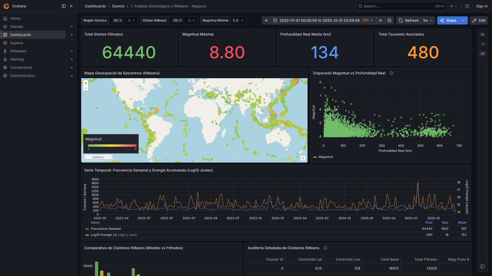
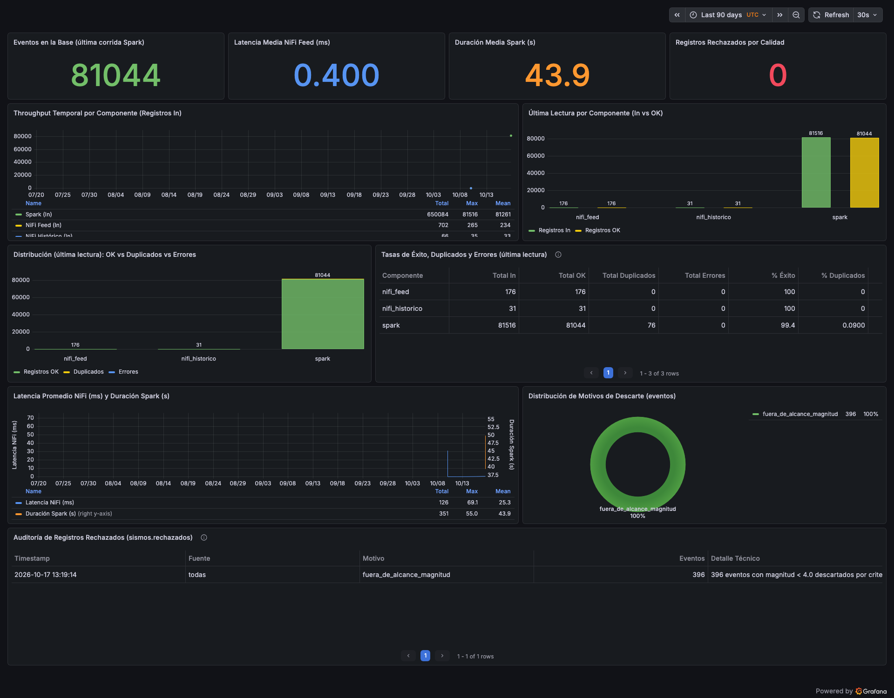

# Monitor Sísmico Global — Proyecto Integrador LCD301

Sistema de big data de extremo a extremo sobre **sismos reales del USGS**: ingesta con Apache NiFi, procesamiento con PySpark, almacenamiento en PostgreSQL particionado, análisis con SQL avanzado y visualización con Grafana aprovisionado como código.

**Arquitectura de Grandes Volúmenes de Datos** · INTEC · Trimestre 11 · Grupo B
Estudiantes: Ezequiel Jiménez · Adonis de los Angeles

---

## Contenido de la entrega

| Carpeta | Qué contiene |
|---|---|
| [`01_Documentacion/`](01_Documentacion/) | Informe técnico end-to-end del proyecto (PDF): arquitectura, decisiones de diseño, estrategias, resultados y conclusiones |
| [`02_Codigo/`](02_Codigo/README.md) | Todo el código fuente, una subcarpeta por capa, con instrucciones de ejecución |
| [`03_Visualizaciones/`](03_Visualizaciones/README.md) | Dashboards de Grafana y evidencias de la ingesta en NiFi, con su índice |
| [`04_Presentacion/`](04_Presentacion/) | Presentación (PPTX) y video |
| `docker-compose.yml`, `.env.example` | Despliegue de todos los servicios con un solo comando |

## Arquitectura

```text
USGS API (feed, cada 5 min) ───────┐
                                   ├─► NiFi ─► data/raw ─► Spark ─► PostgreSQL ──┬─► 5 consultas SQL + benchmark
USGS FDSN (CSV + GeoJSON, 61 meses)┘   (validación,        (limpieza,  (particionada  └─► Grafana (2 dashboards)
                                        dedup, rate limit)  KMeans)     por mes)
```

## Dónde ver cada capa

| Capa | Tecnología | Código | Evidencia |
|---|---|---|---|
| 1. Ingesta | Apache NiFi 2.7.2 | [`02_Codigo/ingesta/`](02_Codigo/ingesta/README.md) | [Capturas de NiFi](03_Visualizaciones/README.md) (15) |
| 2. Procesamiento | PySpark 3.5 (batch + KMeans) | [`02_Codigo/procesamiento/`](02_Codigo/procesamiento/README.md) | Informe, capítulo 6 |
| 3. Almacenamiento | PostgreSQL 16, partición mensual | [`02_Codigo/almacenamiento/`](02_Codigo/almacenamiento/README.md) | Informe, capítulo 7 |
| 4. Análisis y consultas | SQL avanzado + benchmark | [`02_Codigo/analisis/`](02_Codigo/analisis/RENDIMIENTO.md) | [Informe de rendimiento](02_Codigo/analisis/RENDIMIENTO.md) |
| 5. Visualización | Grafana 13 (aprovisionado como código) | `02_Codigo/visualizacion/` | Capturas de abajo |

## Resultados

| | |
|---|---|
| Sismos cargados | **81 044** (2021-10-01 → 2026-10-17, magnitud ≥ 4.0), 46 columnas, 376 regiones |
| Fuentes | API REST en vivo + catálogo histórico (CSV de calidad de medición y GeoJSON de impacto humano) |
| Procesamiento | ~40 s; 0 rechazos; 76 duplicados entre fuentes resueltos; KMeans con 12 zonas sísmicas |
| Almacenamiento | 85 particiones mensuales; carga idempotente; respaldo de 6 MB verificado |
| Rendimiento | La poda de particiones lee **98.6 % menos bloques** y es 58-83× más rápida; el índice B-Tree, 4-15× |
| Visualización | 2 dashboards aprovisionados automáticamente (9 y 11 paneles), sin pasos manuales |
| Componentes adicionales | Docker Compose con todos los servicios, aprendizaje automático (KMeans), aprovisionamiento como código, respaldo y restauración verificados |




---

## Cómo ejecutarlo

Requisito: Docker Desktop.

```bash
cp .env.example .env            # cambiar las contraseñas si se desea (NiFi exige >= 12 caracteres)
docker compose up -d postgres grafana

# Cargar los datos: restaurar el respaldo publicado (~1 min)
mkdir -p data/backups
curl -L -o data/backups/sismos_20261017_092202.dump \
  https://github.com/ezejivilla-dotcom/proyecto-final-monitor-sismico/releases/download/datos-v2/sismos_20261017_092202.dump
docker exec -i sismos-postgres pg_restore -U sismos -d sismos --data-only --no-owner < data/backups/sismos_20261017_092202.dump
```

- **Grafana:** <http://localhost:3000> (acceso anónimo local). Los dos dashboards están en la carpeta *Sismos*.
- **PostgreSQL:** `localhost:5433` (usuario, base y clave del `.env`).
- **Regenerar todo desde las fuentes del USGS** (NiFi + Spark, ~10 minutos) y detalle por capa: [`02_Codigo/README.md`](02_Codigo/README.md).

### Consultas y benchmark (capa 4)

```bash
for f in 02_Codigo/analisis/0*.sql; do docker exec -i sismos-postgres psql -U sismos -d sismos < "$f"; done

pip install psycopg2-binary
python 02_Codigo/analisis/medir_rendimiento.py     # lee el .env y regenera 02_Codigo/analisis/RENDIMIENTO.md
```
